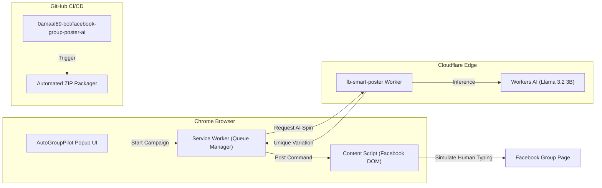

# 🚀 AutoGroupPilot — AI Facebook Group Poster

> **Smart, Safe & Automated Multi-Group Poster for Facebook**  
> An open, subscription-free alternative to *MultipleGroupPoster.com*, supercharged with **Cloudflare Workers AI** (Llama 3.2) and enterprise-grade anti-ban safety emulation.

[](https://github.com/0amaal89-bot/facebook-group-poster-ai/actions)
[](LICENSE)
[](https://developer.chrome.com/docs/extensions/mv3/intro/)
[-F38020.svg)](https://developers.cloudflare.com/workers-ai/)

---

## 🌟 Why AutoGroupPilot?

Standard bulk posters get accounts banned because they fire identical posts with robotic timing through external servers. **AutoGroupPilot** is architected from the ground up for **100% account longevity and human mimicry**:

| Feature | Typical Posters / MultipleGroupPoster | AutoGroupPilot (Our Solution) |
| :--- | :--- | :--- |
| **Price** | \$19 - \$49 / month | **100% Free & Open Source** |
| **Post Variation** | Basic Spintax only | **Cloudflare Workers AI (Llama 3.2)** dynamic rewrites + Spintax |
| **Link Safety** | Risk of group ban | **Auto 1st Comment Engine** (delivers link in comment #1) |
| **Timing Pattern** | Fixed robotic delays | **Gaussian Jitter Delays (30s – 210s)** |
| **Browser Execution** | Remote servers (detected as bots) | **Real Chrome Session** (authenticated cookies, zero bot flags) |
| **Human Emulation** | Instant DOM paste | **Feed scrolling presence + human character typing** |
| **Circuit Breakers** | None | **Auto-detects Facebook checkpoint modals & halts** |

---

## ⚡ Architecture: Cloudflare + Chrome + GitHub



---

## 🛠️ Components

### 1. Chrome Extension (`/extension`)
* **Manifest V3** compliant.
* **Smart Auto-Sync**: Auto-detects joined groups from `facebook.com/groups/joins/`.
* **Group Bundles**: Group communities into audience bundles (e.g., *Real Estate, Marketing, Buy & Sell*).
* **Anti-Ban Presets**:
  * **Maximum Safety**: 90s - 210s delays, feed scrolling, human typing simulation, 12 min cool-down every 6 posts.
  * **Balanced (Recommended)**: 45s - 90s delays, human typing, 10 min cool-down every 8 posts.
  * **Turbo**: 25s - 50s delays for seasoned accounts.
* **Live Monitor**: Visual progress bar, countdown timer, success/fail counters, and real-time audit log.

### 2. Cloudflare Workers AI Backend (`/cloudflare-worker`)
* **Deployed Endpoint**: `https://fb-smart-poster.0amaal89.workers.dev`
* **Model**: `@cf/meta/llama-3.2-3b-instruct` (Ultra-fast, zero cold-start).
* **Endpoints**:
  * `POST /api/ai/spin`: Rewrites post with customizable tone and intensity while keeping URLs and contact info intact.
  * `POST /api/ai/spintax`: Automatically converts plain text into rich `{A|B|C}` Spintax.
  * `POST /api/ai/first-comment`: Strips links from post body and constructs engaging 1st comment hooks.
  * `POST /api/ai/safety-audit`: Flags spam triggers and risky claims before publishing.

---

## 🚀 Quick Start & Installation

### Step 1: Load the Chrome Extension
1. Clone or download this repository.
2. In Google Chrome, navigate to `chrome://extensions`.
3. Enable **Developer mode** (toggle in the top-right corner).
4. Click **Load unpacked**.
5. Select the `extension` folder inside this repository:
   ```
   facebook-group-poster-ai/extension
   ```
6. The **AutoGroupPilot** icon will appear in your Chrome toolbar!

### Step 2: Auto-Sync Your Facebook Groups
1. Open [Facebook](https://www.facebook.com) and ensure you are logged into your account.
2. Click the **AutoGroupPilot** extension icon.
3. Switch to the **Groups** tab and click **Sync from Facebook**.
4. The extension will scan and import all your joined groups automatically!

### Step 3: Run Your First AI-Powered Campaign
1. In the **Composer** tab, type your post message.
2. (Optional) Click **Spin Preview** to test Cloudflare Workers AI.
3. (Optional) Turn on **Auto First-Comment** to place your links in comment #1.
4. Select your target groups or a saved bundle.
5. Click **Start Campaign** and watch the live progress in the **Monitor** tab!

---

## 🛡️ Anti-Ban Best Practices
1. **Always use Balanced or Maximum Safety** when posting to more than 20 groups.
2. **Enable Cloudflare AI Spin** so Facebook's algorithms see unique content in every group.
3. **Use Auto First Comment** for external links to bypass strict moderation rules.
4. Keep daily posts under **30-40 groups per account** for maximum safety.

---

## 📄 License
MIT © 2026 [0amaal89-bot](https://github.com/0amaal89-bot)
